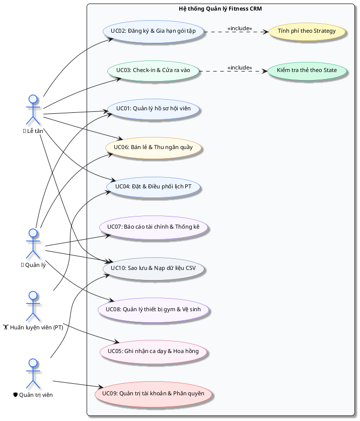

# 🏋️ Fitness CRM (C++20)

Hệ thống quản lý trung tâm thể hình toàn diện bằng **C++20**: Quản lý hồ sơ hội viên, vòng đời thẻ & gói tập linh hoạt, huấn luyện viên cá nhân (PT) & xếp lịch hẹn không trùng, kiểm soát ra vào (Check-in/out), quản lý tủ đồ, bán lẻ & tồn kho, hóa đơn & công nợ, nhân sự & tính lương đa hình, cơ sở vật chất & vệ sinh, chăm sóc khách hàng (CSKH), phản hồi và báo cáo doanh thu tài chính.

> 💡 **Mẹo xem tài liệu trên GitHub:** Repo này tích hợp sẵn mã nguồn biểu đồ **PlantUML**. Bạn có thể cài đặt tiện ích mở rộng [PlantUML for GitHub](https://github.com/plantuml/plantuml-for-github) trên Chrome / Firefox để GitHub tự động kết xuất trực tiếp các khối mã sơ đồ thành hình ảnh SVG sắc nét ngay trong trang này!

---

## 🏛️ Kiến trúc hướng đối tượng & Biểu đồ UML (PlantUML)

Hệ thống được thiết kế theo chuẩn **UML 2.0**, phân tách rõ ràng giữa tầng giao diện (Console / Win32 / Web), tầng điều phối (`HethongCRM`), tầng miền nghiệp vụ (`Nguoi`, `HoiVien`, `NhanVien`, `PT`, `HoaDon`, `GoiDichVu`) và áp dụng các mẫu thiết kế hướng đối tượng kinh điển (**GoF Design Patterns**).

### 1. Sơ đồ ca sử dụng (Use Case Diagram)

Mô hình hóa các nhóm tác vụ nghiệp vụ gắn liền với 4 tác nhân chính: **Lễ tân**, **Quản lý**, **Huấn luyện viên (PT)** và **Quản trị viên (Admin)**.



---

### 2. Sơ đồ lớp chi tiết (Class Diagram - Khớp 100% C++20)

Sơ đồ mô tả đầy đủ:
* **Tính kế thừa (`Inheritance`)**: `Nguoi` $\to$ `HoiVien`, `Nguoi` $\to$ `NhanVien`, `NhanVien` $\to$ `PT`.
* **State Pattern**: `TrangThaiThe` (`Moi`, `KichHoat`, `DongBang`, `HetHan`) quản lý vòng đời và điều kiện check-in của `HoiVien`.
* **Strategy Pattern**: `ChienLuocGia` (`GiaTieuChuan`, `GiaTheoHangThanhVien`) tách rời thuật toán tính phí khỏi `GoiDichVu`.
* **Hợp thành (`Composition`) & Thu nạp (`Aggregation`)**: `HoaDon` *-- `DongHang`, `HethongCRM` o-- các thực thể nghiệp vụ.

```plantuml
@startuml ClassDiagram_FitnessCRM
skinparam roundCorner 12
skinparam shadowing true
skinparam defaultFontName "Segoe UI"
skinparam defaultFontSize 11
skinparam defaultFontStyle bold
skinparam linetype ortho

skinparam class<<Abstract>> {
    BackgroundColor #F8FAFC
    BorderColor #64748B
    HeaderBackgroundColor #E2E8F0
}
skinparam class<<Domain>> {
    BackgroundColor #FFF7ED
    BorderColor #F97316
    HeaderBackgroundColor #FFEDD5
}
skinparam class<<Pattern>> {
    BackgroundColor #ECFDF5
    BorderColor #10B981
    HeaderBackgroundColor #D1FAE5
}
skinparam class<<Finance>> {
    BackgroundColor #FFFBEB
    BorderColor #F59E0B
    HeaderBackgroundColor #FEF3C7
}
skinparam class<<Controller>> {
    BackgroundColor #FAF5FF
    BorderColor #8B5CF6
    HeaderBackgroundColor #EDE9FE
}

abstract class Nguoi <<Abstract>> {
    # ma_ : std::string
    # ten_ : std::string
    # Nguoi(ma: string, ten: string)
    # doiTen(ten: string) : void
    + {abstract} ~Nguoi()
    + ma() : const std::string&
    + ten() : const std::string&
    + {abstract} vaiTro() : std::string
}

class HoiVien <<Domain>> {
    - sdt_ : std::string
    - ngaySinh_ : Date
    - ngayHetHan_ : Date
    - sinhVien_ : bool
    - soBuoiConLai_ : int
    - gioiHanBuoi_ : bool
    - lichSuCheckIn_ : std::vector<std::string>
    - hang_ : std::string
    - maThe_ : std::string
    - maPT_ : std::string
    - goiHienTai_ : std::string
    - ngayBaoLuu_ : Date
    - soBuoiPT_ : int
    + HoiVien(ma, ten, sdt, ngaySinh, sinhVien)
    + ~HoiVien()
    + vaiTro() : std::string
    + duocCheckIn() : bool
    + kichHoat(hetHan: Date, soBuoi: int, gioiHan: bool) : void
    + dongBang() : void
    + moBang() : void
    + baoLuu(tuNgay: Date) : void
    + moBaoLuu(ngay: Date) : int
    + datTrangThai(state: unique_ptr<TrangThaiThe>) : void
    + operator++() : HoiVien&
}

class NhanVien <<Domain>> {
    # chucVu_ : std::string
    # sdt_ : std::string
    # luongCoBan_ : double
    # tyLeHoaHong_ : double
    # ngayVaoLam_ : Date
    # dangLam_ : bool
    + NhanVien(ma, ten, chucVu, sdt, luong, hoaHong, ngayVao)
    + ~NhanVien()
    + vaiTro() : std::string
    + hoaHong(ky: KyLuong) : double
    + {virtual} tinhLuong(ky: KyLuong) : double
}

class PT <<Domain>> {
    - chuyenMon_ : std::string
    - doanhThuCaNhan_ : double
    - soCaDaDay_ : int
    - donGiaBuoi_ : double
    - gioBatDau_ : int
    - gioKetThuc_ : int
    + PT(ma, ten, chuyenMon)
    + vaiTro() : std::string
    + ghiNhanBuoiDay(doanhThu: double) : void
    + trongCaLam(phutBatDau, phutKetThuc) : bool
    + tinhLuong(ky: KyLuong) : double
}

interface TrangThaiThe <<Pattern>> {
    + {abstract} ~TrangThaiThe()
    + {abstract} ten() : std::string
    + {abstract} kichHoat(hv: HoiVien&) : void
    + {abstract} dongBang(hv: HoiVien&) : void
    + {abstract} moBang(hv: HoiVien&) : void
    + {abstract} danhDauHetHan(hv: HoiVien&) : void
    + {virtual} duocCheckIn() : bool
}
class TrangThaiMoi <<Pattern>> implements TrangThaiThe
class TrangThaiKichHoat <<Pattern>> implements TrangThaiThe
class TrangThaiDongBang <<Pattern>> implements TrangThaiThe
class TrangThaiHetHan <<Pattern>> implements TrangThaiThe

interface ChienLuocGia <<Pattern>> {
    + {abstract} ~ChienLuocGia()
    + {abstract} ten() : std::string
    + {abstract} tinhPhiDichVu(hv, goi, voucher) : double
}
class GiaTieuChuan <<Pattern>> implements ChienLuocGia
class GiaTheoHangThanhVien <<Pattern>> implements ChienLuocGia

class GoiDichVu <<Domain>> {
    - ma_ : std::string
    - ten_ : std::string
    - kieu_ : LoaiGoi
    - soThang_ : int
    - gia_ : double
    - giaSV_ : double
    - dangBan_ : bool
    + tinhPhiDichVu(hv, strategy, voucher) : double
    + tinhNgayHetHan(batDau: Date) : Date
}

class HoaDon <<Finance>> {
    - ma_ : std::string
    - maHoiVien_ : std::string
    - ngay_ : std::string
    - loai_ : std::string
    - phuongThuc_ : std::string
    - giamGia_ : double
    - daThanhToan_ : double
    + themHang(ten, soLuong, donGia, maSP) : void
    + tongTien() : double
    + ghiNhanThanhToan(daTra, phuongThuc) : void
}

class DongHang <<Finance>> {
    + ten : std::string
    + soLuong : int
    + donGia : double
    + maSanPham : std::string
    + thanhTien() : double
}

class LichHen <<Domain>> {
    - ma_ : std::string
    - maHoiVien_ : std::string
    - maPT_ : std::string
    - batDau_ : sys_seconds
    - ketThuc_ : sys_seconds
    - trangThai_ : std::string
    + trungLich(other: LichHen) : bool
    + thoiLuongPhut() : int
}

class CheckIn <<Domain>> {
    - maHoiVien_ : std::string
    - vao_ : DateTime
    - ra_ : DateTime
    - phuongThuc_ : std::string
    - maTu_ : std::string
    + checkOut(luc: DateTime) : void
    + daRa() : bool
}

class HethongCRM <<Controller>> {
    - hoiViens_ : std::map<string, shared_ptr<HoiVien>>
    - pts_ : std::map<string, unique_ptr<PT>>
    - nhanViens_ : std::map<string, unique_ptr<NhanVien>>
    - goiDichVus_ : std::map<string, GoiDichVu>
    - hoaDons_ : std::vector<HoaDon>
    - lichHens_ : std::vector<LichHen>
    - checkIns_ : std::vector<CheckIn>
    - chienLuocGia_ : unique_ptr<ChienLuocGia>
    + themHoiVien(hv) : void
    + dangKyGoi(...) : KetQuaDangKy
    + checkIn(maHV, phuongThuc) : void
    + checkOut(maHV) : void
    + datLich(maHV, maPT, batDau, ketThuc) : void
    + docCSV(thuMuc) : void
    + luuCSV(thuMuc) : void
}

Nguoi <|-- HoiVien
Nguoi <|-- NhanVien
NhanVien <|-- PT

HoiVien o-- "1" TrangThaiThe : <<State Pattern>>
HoaDon *-- "*" DongHang : <<Composition>>

HethongCRM o-- "*" HoiVien
HethongCRM o-- "*" PT
HethongCRM o-- "*" GoiDichVu
HethongCRM *-- "1" ChienLuocGia : <<Strategy Pattern>>
HethongCRM *-- "*" HoaDon
HethongCRM *-- "*" LichHen
HethongCRM *-- "*" CheckIn
@enduml
```



---

### 3. Biểu đồ tuần tự (Sequence Diagrams)

#### Luồng 1: Đăng ký gói tập, tính giá động (Strategy) & Xuất hóa đơn
Minh họa luồng thông điệp khi nhân viên quầy thực hiện đăng ký dịch vụ:

```plantuml
@startuml Sequence_DangKyGoi
autonumber "<b>[00]</b>"
skinparam roundCorner 10
skinparam shadowing true
skinparam defaultFontName "Segoe UI"
skinparam defaultFontSize 11
skinparam defaultFontStyle bold

actor "💁 Lễ tân" as Staff #EFF6FF;line:2563EB
participant "💻 MenuConsole" as UI #FFE4E6;line:F43F5E
participant "⚙️ HethongCRM" as CRM #EDE9FE;line:8B5CF6
participant "👤 HoiVien" as HV #D1FAE5;line:10B981
participant "📦 GoiDichVu" as Goi #D1FAE5;line:10B981
participant "🎯 ChienLuocGia" as Strat #DCFCE7;line:22C55E
participant "🧾 HoaDon" as HD #FEF3C7;line:F59E0B

Staff -> UI: Chọn [2] Đăng ký gói (maHV, maGoi, maKM, daTra)
activate UI

UI -> CRM: dangKyGoi(maHV, maGoi, maKM, maNV, daTra, phuongThuc)
activate CRM

CRM -> CRM: timHoiVien(maHV) & timGoi(maGoi)
CRM -> Goi: tinhNgayHetHan(today())
Goi --> CRM: denNgay (Date)

note over Goi, Strat #ECFDF5
  <b>Strategy Pattern:</b>
  Tính giá theo đối tượng (sinh viên/hạng thẻ) và áp dụng voucher
end note

CRM -> Goi: tinhPhiDichVu(hv, *chienLuocGia_, voucher)
activate Goi
Goi -> Strat: tinhPhiDichVu(hv, goi, voucher)
activate Strat
Strat --> Goi: phiCuoiCung (double)
deactivate Strat
Goi --> CRM: phiCuoiCung
deactivate Goi

note over CRM, HV #EFF6FF
  <b>State Pattern:</b>
  Cập nhật trạng thái thẻ sang Kích hoạt
end note

CRM -> HV: kichHoat(denNgay, soBuoi, gioiHan)
activate HV
HV -> HV: datTrangThai(taoTrangThaiKichHoat())
HV --> CRM: hoàn tất
deactivate HV

create HD
CRM -> HD: HoaDon(maHD, maHV, today())
CRM -> HD: themHang(tenGoi, 1, phiCuoiCung, maGoi)
CRM -> HD: ghiNhanThanhToan(daTra, phuongThuc)
CRM -> CRM: themHoaDon(hd)

CRM --> UI: KetQuaDangKy (maHD, phiCuoiCung, denNgay)
deactivate CRM

UI --> Staff: In thông báo thành công & Hóa đơn cho khách
deactivate UI
@enduml
```

#### Luồng 2: Check-in cửa phòng tập (State Pattern & Kiểm soát lượt)
Minh họa cơ chế từ chối khi thẻ bảo lưu/hết hạn và trừ buổi khi thẻ hợp lệ:

```plantuml
@startuml Sequence_CheckIn
autonumber "<b>[00]</b>"
skinparam roundCorner 10
skinparam shadowing true
skinparam defaultFontName "Segoe UI"
skinparam defaultFontSize 11
skinparam defaultFontStyle bold

actor "💁 Lễ tân / Cổng quét" as Staff #EFF6FF;line:2563EB
participant "💻 MenuConsole" as UI #FFE4E6;line:F43F5E
participant "⚙️ HethongCRM" as CRM #EDE9FE;line:8B5CF6
participant "👤 HoiVien" as HV #D1FAE5;line:10B981
participant "💳 TrangThaiThe" as State #DCFCE7;line:22C55E
participant "🚪 CheckIn" as CI #FEF3C7;line:F59E0B

Staff -> UI: Quẹt thẻ / Nhập maHV
activate UI

UI -> CRM: checkIn(maHV, "Thẻ từ")
activate CRM

CRM -> CRM: luotDangMo(maHV)
alt Đang có lượt tập chưa Check-out
    CRM --> UI: throw runtime_error("Hội viên chưa check-out!")
    UI --> Staff: Báo lỗi: Hội viên đang trong phòng tập
else Chưa có lượt mở
    CRM -> HV: duocCheckIn()
    activate HV
    HV -> State: duocCheckIn()
    activate State
    State --> HV: boolean (true / false)
    deactivate State
    
    alt false (Thẻ Mới, Đóng băng bảo lưu hoặc Hết hạn)
        HV --> CRM: false
        CRM --> UI: throw logic_error("Thẻ không đủ điều kiện vào phòng")
        UI --> Staff: Từ chối cửa: Yêu cầu mở bảo lưu hoặc gia hạn
    else true (Thẻ Kích hoạt hợp lệ)
        HV --> CRM: true
        deactivate HV
        
        CRM -> HV: operator++()
        activate HV
        HV -> HV: Trừ số buổi (nếu gói buổi) & lưu lịch sử tập
        deactivate HV
        
        create CI
        CRM -> CI: CheckIn(maHV, now(), "Thẻ từ")
        CRM -> CRM: checkIns_.push_back(ci)
        CRM --> UI: Thành công
        deactivate CRM
        UI --> Staff: Màn hình xanh: Mở cửa cho hội viên vào
    end
end
deactivate UI
@enduml
```

---

## 💻 Các phiên bản giao diện

Hệ thống hỗ trợ 3 tùy chọn giao diện chạy trên cùng một lõi nghiệp vụ `HethongCRM` và kho dữ liệu CSV:

1. **Giao diện Win32 Desktop (`winversion/`)**: Ứng dụng native C++ dùng Win32 API thuần (không phụ thuộc Qt/Raylib), hỗ trợ 16 màn hình quản trị, dashboard KPI biểu đồ GDI, form nhập liệu và ListView ảo. Xem hướng dẫn tại [winversion/README.md](winversion/README.md).
2. **Giao diện Web (`webversion/`)**: Máy chủ backend C++20 và frontend SPA JavaScript, cung cấp dashboard, tra cứu hội viên, check-in/out từ xa qua trình duyệt. Xem hướng dẫn tại [webversion/README.md](webversion/README.md).
3. **Giao diện Console (`src/MenuConsole.cpp`)**: Menu dòng lệnh văn bản phân tầng, tối ưu cho thao tác quầy nhanh bằng phím bấm, hỗ trợ màu ANSI Dark Ocean và font UTF-8 tiếng Việt.
4. **Interactive Architecture Showcase (`fitness_crm_showcase.html`)**: Trang trình diễn kiến trúc trực quan, xem sơ đồ vector động và bảng Design Tokens bằng cách mở file trong trình duyệt.

---

## 🛠️ Hướng dẫn Biên dịch (Build)

### 1. Dùng CMake (Khuyên dùng)
Yêu cầu trình biên dịch hỗ trợ **C++20** (MinGW-w64 GCC 11+, Clang 13+, hoặc Visual Studio 2022) cùng CMake 3.20+:

```powershell
cmake -S . -B build
cmake --build build --config Release
```

* File thực thi console: `build/fitness_crm.exe`
* File thực thi Win32: `build/fitness_crm_win.exe` (hoặc chạy file `build.bat` trong thư mục `winversion/`).

### 2. Biên dịch thủ công Console bằng MSYS2 MinGW-w64
```powershell
$sources = Get-ChildItem src -Filter *.cpp | Where-Object { $_.Name -ne 'main_gui.cpp' } | ForEach-Object { $_.FullName }
g++ -std=c++20 -Wall -Wextra -Wpedantic -I include $sources -o fitness_crm.exe
```

---

## 📂 Quản lý dữ liệu CSV (data/ & sample_data/)

* **Cơ chế an toàn:** Lưu trữ qua file tạm `.tmp` rồi đổi tên (*atomic replace*), đảm bảo không làm rách file khi tiến trình bị ngắt đột ngột.
* **Bộ dữ liệu mẫu (`sample_data/`):** Đi kèm 24 tệp CSV với 180 hồ sơ hội viên, ~650 hóa đơn, ~2.800 lượt check-in, lịch PT và bảng chấm công thực tế để trình diễn và kiểm thử.
* **Định dạng:** Thống nhất mã hóa UTF-8, tự động bỏ qua dòng lỗi và ghi cảnh báo thay vì làm dừng toàn bộ ứng dụng.

---

## 👥 Phân công nhiệm vụ nhóm (Mã nguồn & Báo cáo LaTeX)

| Thành viên | Nhiệm vụ mã nguồn C++ & Trách nhiệm chính | File phụ trách | Báo cáo LaTeX (Overleaf) |
|---|---|---|---|
| **Nguyễn Đức Tài** | **Module Hội viên & State Pattern**<br>Quản lý hồ sơ hội viên, vòng đời thẻ (`Moi`, `KichHoat`, `DongBang`, `HetHan`), bảo lưu và bù ngày. | `Nguoi.cpp`<br>`HoiVien.cpp`<br>`TrangThaiThe.cpp` | **Viết Chương 2:** Mô hình hóa Class HoiVien. Viết giải trình lý thuyết State Pattern. |
| **Tôn Thất Thành Tài** | **Module Dịch vụ & Tính phí Strategy**<br>Gói tập linh hoạt, chiến lược giá (`ChienLuocGia`, `GiaTieuChuan`, `GiaTheoHangThanhVien`), voucher & khuyến mãi, hóa đơn & thu ngân. | `GoiDichVu.cpp`<br>`Voucher.cpp`<br>`KhuyenMai.cpp`<br>`HoaDon.cpp`<br>`DongHang.cpp` | **Viết Chương 3:** Giải trình kỹ thuật Đa hình (Polymorphism) và Strategy Pattern đã áp dụng. |
| **Lâm Gia Luân** | **Module PT & Validate lịch trùng**<br>Nhân viên & Huấn luyện viên (PT), tính lương đa hình theo ca dạy, kiểm soát lịch hẹn không chồng lấn bằng `<chrono>`. | `NhanVien.cpp`<br>`PT.cpp`<br>`LichHen.cpp`<br>`DateUtils.cpp` | **Viết Chương 3:** Phân tích quan hệ Association/Aggregation giữa PT và HoiVien. |
| **Hồ Gia Huệ** | **Module Check-in & Toán tử**<br>Kiểm soát ra vào cổng, tủ đồ, InBody, thiết bị & bảo trì, biên bản vệ sinh, nạp chồng toán tử (`operator++`, `operator<<`, `operator>>`). | `CheckIn.cpp`<br>`TuDo.cpp`<br>`InBody.cpp`<br>`ThietBi.cpp`<br>`KiemTraVeSinh.cpp` | **Viết Chương 3:** Giải trình kỹ thuật Operator Overloading và các ràng buộc dữ liệu InBody. |
| **Nguyễn Lê Quý Trọng** | **Module Tích hợp, Core & Test Data**<br>Điều phối `HethongCRM`, lưu trữ CSV an toàn, kịch bản kiểm thử, tài khoản, menu Console và ứng dụng Win32/Web. | `HethongCRM.cpp`<br>`LuuTru.cpp`<br>`BaoCao.cpp`<br>`TaiKhoan.cpp`<br>`MenuConsole.cpp` | **Viết Chương 4:** Lên kịch bản Test Cases (Thử nghiệm nhập sai, test rò rỉ bộ nhớ). |
